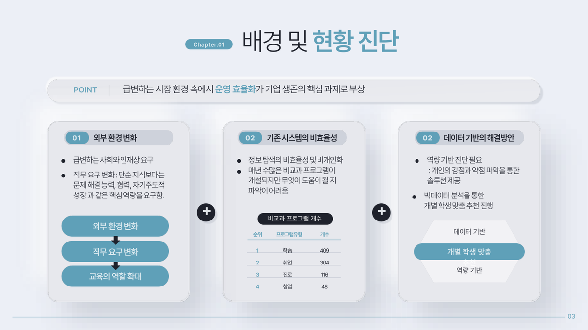
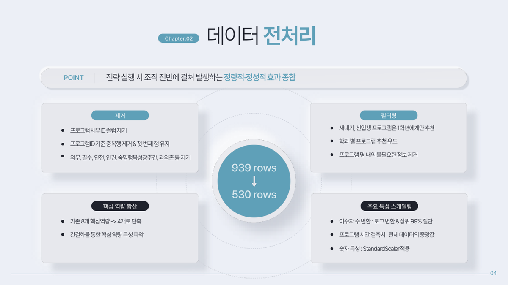
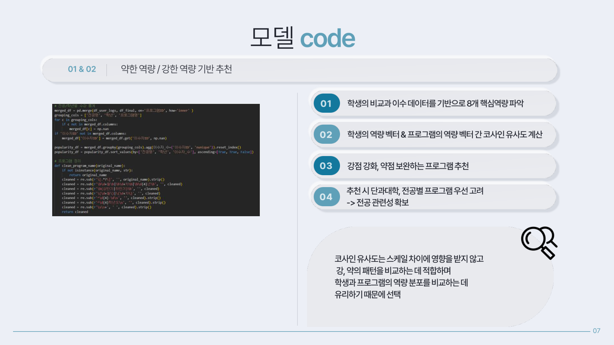
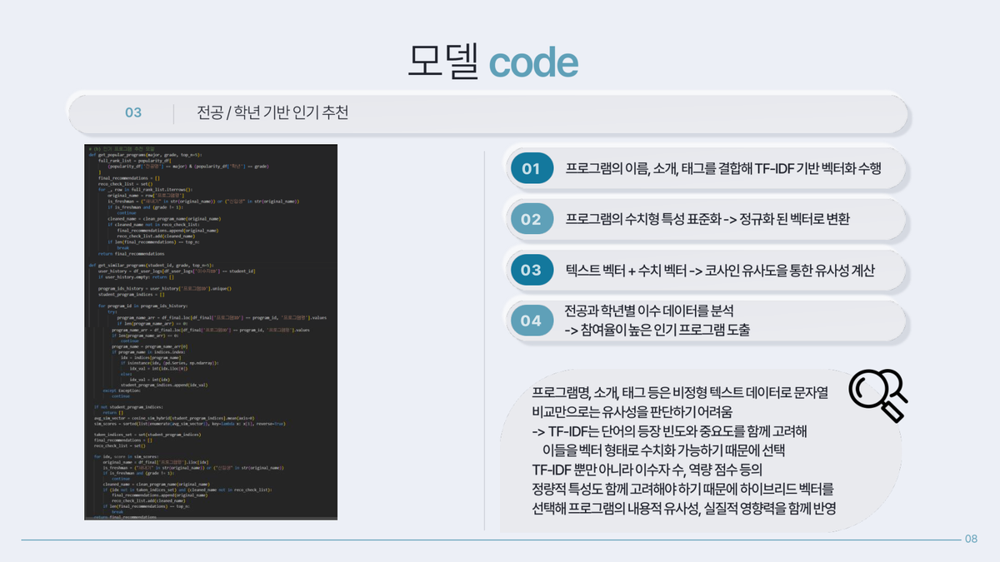
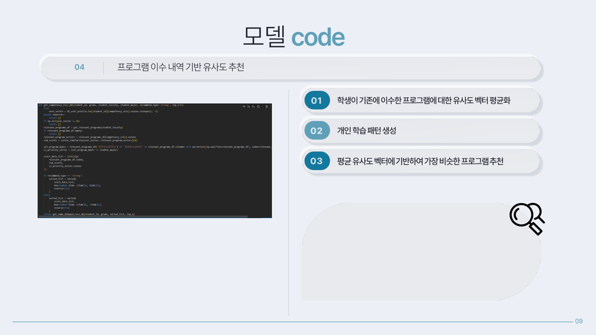
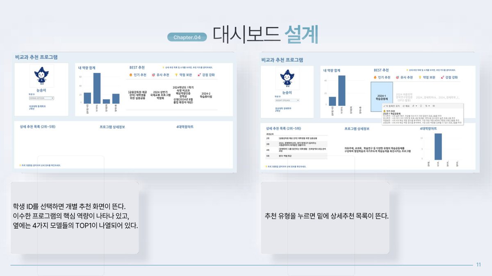
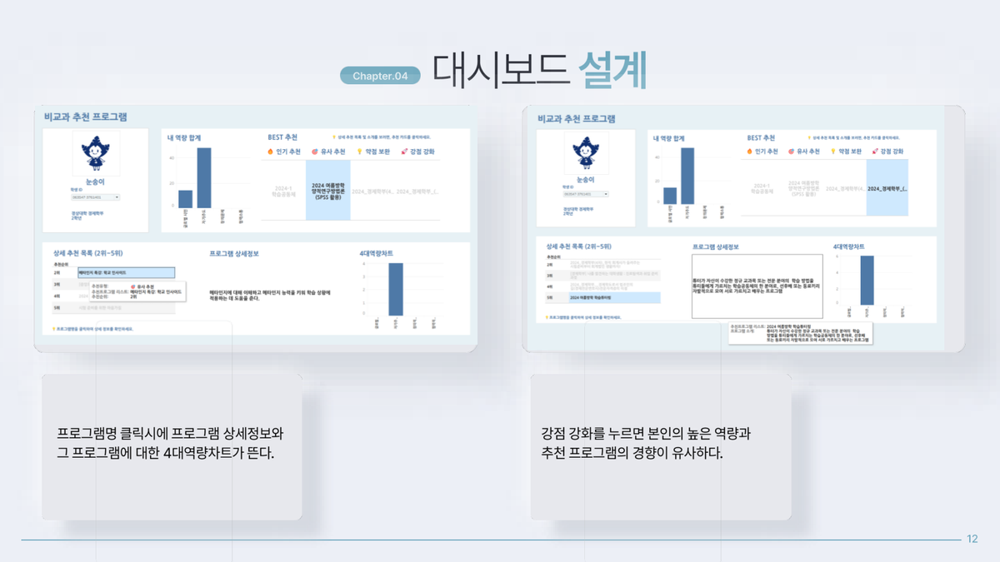
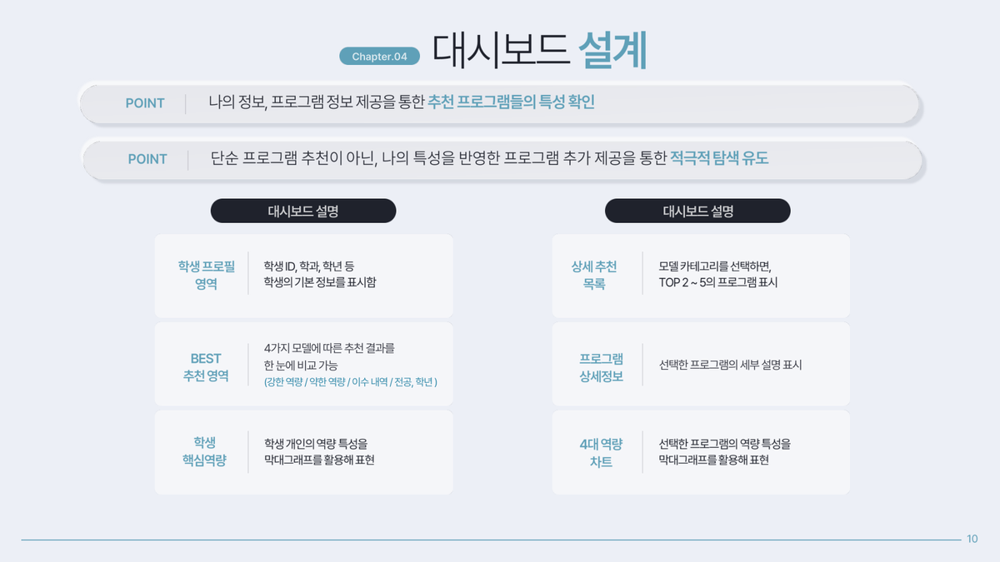
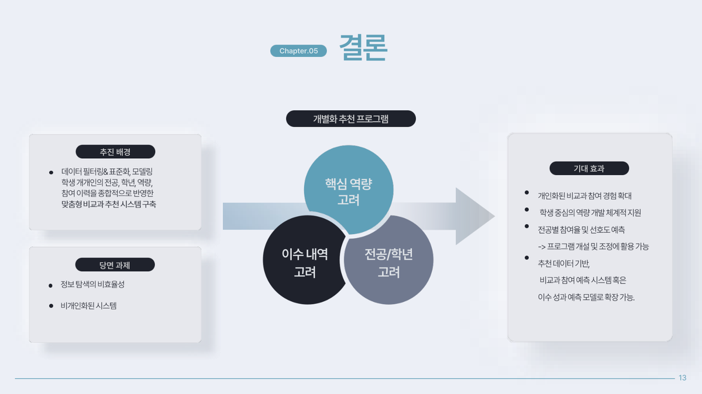

<div align="center">

# 🎓 비교과 프로그램 개별 추천 시각화

### 태블로를 활용한 학생 맞춤 비교과 프로그램 추천 대시보드


</div>

---

## 🏆 수상

| | |
| --- | --- |
| **🎖️ 우수상** | 「제4회 2025학년도 **SM-Data를 활용한 데이터 분석 공모전**」 — 숙명여자대학교 교육혁신원 · 팀 지원 (팀 송송) |

## 📌 프로젝트 정보

| | |
| --- | --- |
| **프로젝트명** | 태블로를 활용한 비교과 프로그램 개별 추천 시각화 |
| **공모전** | 제4회 2025학년도 SM-Data를 활용한 데이터 분석 공모전 (숙명여자대학교 교육혁신원) |
| **팀** | 팀 송송 |
| **발표자료** | [📄 presentation.pdf](docs/presentation.pdf) (13쪽) |
| **스택** | Python (전처리 · TF-IDF · 코사인 유사도) · Tableau |

<!-- TODO: 팀원 이름을 적을 경우 아래 '팀' 섹션에 추가하세요 -->

## 💡 문제 정의

학교에는 매년 수많은 비교과 프로그램이 개설되지만, **어떤 프로그램이 나에게 도움이 되는지 찾기 어렵습니다.** 정보 탐색은 비효율적이고 추천은 비개인화되어 있습니다.

- **외부 환경 변화** — 직무 요구가 단순 지식에서 문제해결 · 협력 · 자기주도성 같은 **핵심 역량** 중심으로 이동
- **기존 시스템의 비효율** — 프로그램은 많지만(학습 409 · 취업 304 · 진로 116 · 창업 48개) 무엇이 도움이 될지 파악이 어려움
- **데이터 기반 해결** — 개인의 강점과 약점을 파악하는 **역량 기반 진단**으로 학생 맞춤 추천 제공

<div align="center">

</div>

## 🧹 데이터 전처리

데이터를 **939행 → 530행**으로 정제했습니다.

| 구분 | 내용 |
| --- | --- |
| **제거** | 프로그램 세부ID 컬럼 제거 · 프로그램ID 기준 중복행 제거(첫 번째 행 유지) · 의무·필수·안전·인권·숙명행복성장주간·과의존 등 일반 프로그램 제외 |
| **필터링** | 새내기·신입생 프로그램은 1학년에게만 추천 · 학과별 프로그램 추천 유도 · 프로그램명 내 불필요한 정보 제거 |
| **핵심 역량 합산** | 기존 8개 핵심 역량 → **4개로 단축**해 특성을 간결하게 파악 |
| **스케일링** | 이수자 수는 로그 변환 + 상위 99% 절단 · 프로그램 시간 결측치는 전체 중앙값 · 수치 특성은 StandardScaler 적용 |

<div align="center">

</div>

## 🤖 추천 모델 설계 — 4가지 관점

한 가지 기준이 아니라 **4가지 서로 다른 관점의 추천**을 만들어, 학생이 비교해 보고 고를 수 있게 했습니다.

| 모델 | 방식 |
| --- | --- |
| **01 · 02 강한 역량 / 약한 역량 기반** | 학생의 비교과 이수 데이터로 핵심 역량을 파악 → 학생 역량 벡터와 프로그램 역량 벡터의 **코사인 유사도** 계산 → 강점을 강화하거나 약점을 보완하는 프로그램 추천. 단과대학·전공별 프로그램을 우선 고려해 전공 관련성 확보 |
| **03 전공 / 학년 기반 인기 추천** | 프로그램 이름·소개·태그를 결합해 **TF-IDF** 벡터화 + 수치형 특성 표준화 → **하이브리드 벡터**로 코사인 유사도 계산. 전공·학년별 이수 데이터를 분석해 참여율 높은 인기 프로그램 도출 |
| **04 프로그램 이수 내역 기반 유사도** | 학생이 이수한 프로그램들의 유사도 벡터를 **평균화**해 개인 학습 패턴을 만들고, 가장 비슷한 프로그램 추천 |

> 코사인 유사도는 스케일 차이에 영향을 받지 않고, 역량의 강·약 **패턴**을 비교하는 데 적합해서 선택했습니다. 텍스트 정보(TF-IDF)만으로는 이수자 수·역량 점수 같은 정량적 특성을 놓치므로 03은 하이브리드 벡터를 썼습니다.

<div align="center">


</div>
<div align="center">

</div>

## 📊 대시보드 (Tableau)

**"단순 프로그램 추천이 아니라, 나의 특성을 반영해 추가 정보를 제공해 적극적 탐색을 유도"** 하는 것이 목표입니다.

| 영역 | 설명 |
| --- | --- |
| 학생 프로필 | 학생 ID, 학과, 학년 등 기본 정보 |
| **BEST 추천** | 4가지 모델(강한 역량 / 약한 역량 / 이수 내역 / 전공·학년)의 추천 결과를 한눈에 비교 |
| 학생 핵심역량 | 학생 개인의 역량 특성을 막대그래프로 표시 |
| 상세 추천 목록 | 모델 카테고리를 선택하면 TOP 2~5위 프로그램 표시 |
| 프로그램 상세정보 | 선택한 프로그램의 세부 설명 |
| 4대 역량 차트 | 선택한 프로그램의 역량 특성을 막대그래프로 표시 |

<div align="center">


</div>

학생 ID를 선택하면 개별 추천 화면이 뜨고, 이수한 프로그램의 핵심 역량과 4가지 모델의 TOP 1이 나란히 표시됩니다. 추천 유형을 누르면 아래에 상세 추천 목록이 나타납니다.

<div align="center">

</div>

## ✅ 결론 및 기대 효과

핵심 역량 · 이수 내역 · 전공/학년, 세 가지를 **종합적으로 고려**한 맞춤형 비교과 추천 시스템을 구축했습니다.

- 개인화된 비교과 참여 경험 확대
- 학생 중심의 역량 개발 체계적 지원
- 전공별 참여율 및 선호도 예측, 프로그램 개설·조정에 활용 가능
- 추천 데이터를 기반으로 비교과 참여 예측 시스템, 이수 성과 예측 모델로 확장 가능

<div align="center">

</div>

## 📁 폴더 구조

```
.
├── docs/
│   ├── presentation.pdf   # 발표자료 전문
│   └── images/            # 발표자료 발췌 (배경 · 전처리 · 모델 · 대시보드 · 결론)
└── README.md
```

## ⚠️ 코드 및 데이터에 대해

- 이 공모전은 학교가 제공한 **SM-Data(학생 단위 비교과 이수 데이터)** 를 사용했습니다. 학생 정보가 포함되어 있어 **원본 데이터와 Tableau 패키지(.twbx)는 공개하지 않았습니다.**
- 모델 코드는 발표자료의 "모델 code" 슬라이드에서 확인할 수 있습니다.

## 👥 팀

팀 송송 — **송은지** 외 팀원
